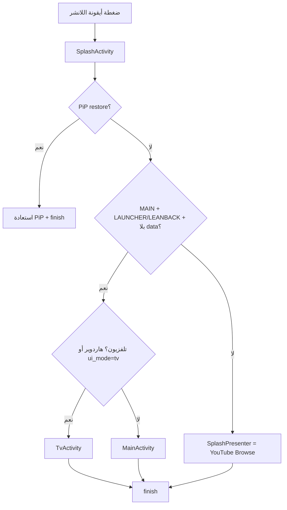
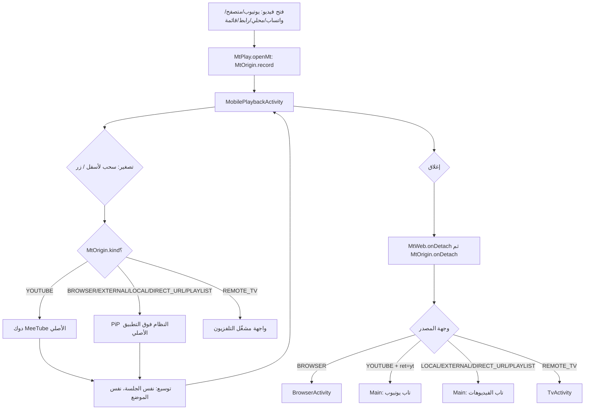
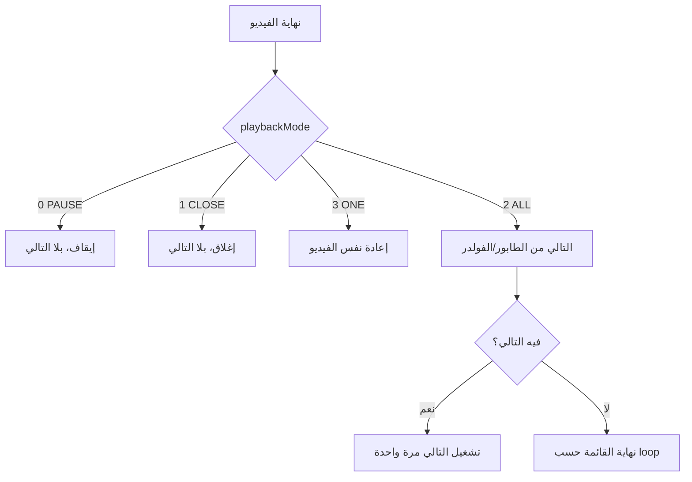

# تدفق الشاشات (PLAYER SCREEN FLOW) — v939

> لم يتم compile ولا اتجرّب على جهاز. المخططات دي بتوصف الكود الحالي (v939) مش سلوك متأكد منه.

## 1. فتح التطبيق من اللانشر



- قبل v939: `isTaskRoot()` كان بيمنع إعادة التوجيه في الضغطة الدافية، و`isRealTv()` كان
  هاردوير بس، فأي جهاز مش بيبلّغ LEANBACK كان بيقع على YouTube Browse.
- بعد v939: `isTvMode()` = هاردوير أو `ui_mode=tv` من تفضيلات `p`؛ ضغطة اللانشر بلا data
  عمرها ما بتقع على الـpresenter — لو الهدف مش قابل للحل بيتقفل التطبيق بدل ما يفتح يوتيوب.
- `Main.onCreate` و`Main.onNewIntent` بيعيدوا نفس الفحص: وضع TV + intent بلا وجهة صريحة
  (لا `tab` ولا `yt_open` ولا `EX_URL` ولا VIEW/SEND ولا `force_phone`) → `TvActivity` + `finish`.

## 2. التشغيل المصدر-واعي (فتح → تصغير → رجوع)



- `MtOrigin` بيتسجّل في `MtPlay.openMt` وبيتقرأ في `MtTranslate.onMinimize` و`MtMedia.detach`.
- `ret` من `MtWeb` (http(s) بس) له الأولوية؛ `MtOrigin` هو الاحتياطي للمصادر اللي مالهاش `ret`
  (واتساب / `content://` / محلي).
- إغلاق من غير `ret` ولا أصل مسجّل = إغلاق عادي من غير تنقّل.

## 3. التلفزيون: ريموت الموبايل → TV

```mermaid
flowchart TD
    PH[موبايل: PlayerPad / أمر صوتي] --> TL[TvLink / BrainRpc]
    TL --> G{مين الشغّال؟}
    G -->|PlayerActivity حي| LEG[مشغّل Joyboy القديم: rAct/rState/rpc]
    G -->|لا قديم + MtTvPlayer حي| MT[MtTvPlayer: act/state]
    G -->|لا حد| NP[noplayer / none]
    MT --> ST[state: الحقول المتنفذة بس]
    ST --> PH2[الموبايل بيخفي اللي مش معلن]
    TL --> FR[/frame: PixelCopy من SurfaceView بتاع MeeTube]
    TL --> SY[/sync: live = hasLive || MtTvPlayer.live]
```

- `mt_tv_player=false` (افتراضي) بيقفل بس توجيه `MtPlay` للتلفزيون للملفات المحلية/المباشرة.
  مسار يوتيوب-على-TV من v928 (ريموت) مش متغطّي بالعلم — تقفيله كان هيكسر الريموت.
- القديم بيفوز دايماً لو حي — مفيش مشغّلين شغالين في نفس الوقت.

## 4. نهاية الفيديو — CLOSE / PAUSE / ONE



- `MtMedia.onEnded` بيطبّق الحارس ده بعد فحص `endOfVideoSleep`. قبل v939 كان فيه خطر
  إن CLOSE/PAUSE يفتحوا التالي بالغلط — الحارس بيمنعه صراحة.
