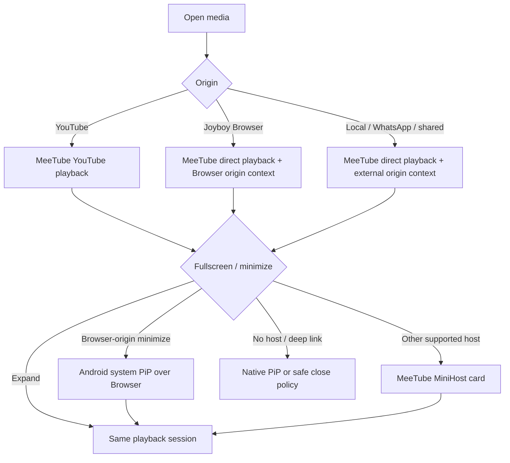
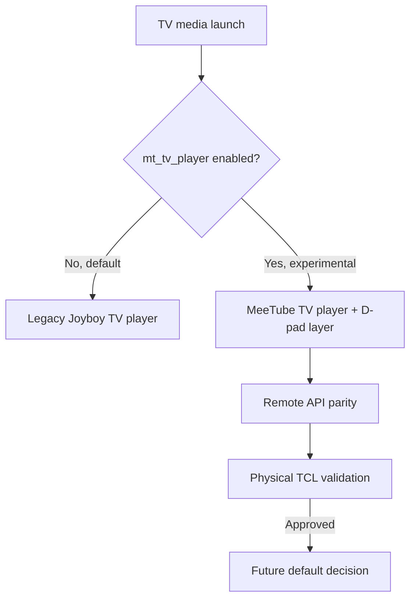

# Player Screen Flow — v939

## Mobile source-aware playback



## Browser-origin minimize decision (v939)

```mermaid
sequenceDiagram
    participant B as Joyboy Browser
    participant P as MtPlay / MtWeb
    participant M as MobilePlaybackActivity
    participant S as Android PiP
    B->>P: Open stream with ret=browser, page/ref, headers
    P->>P: Store source metadata by media URI
    P->>M: Open MeeTube playback
    M->>P: Ask preferSystemPip for current source
    P-->>M: true for ret=browser
    M->>S: Enter system PiP; skip BrowseView MiniHost fallback
    S-->>B: Browser remains visible underneath
```

## Android TV route



The v939 implementation creates the opt-in flag but deliberately does not claim that the experimental route is ready. Legacy TV playback remains the default.
