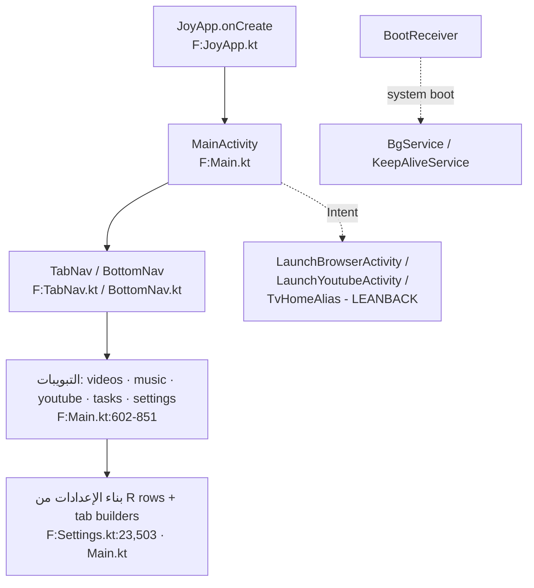
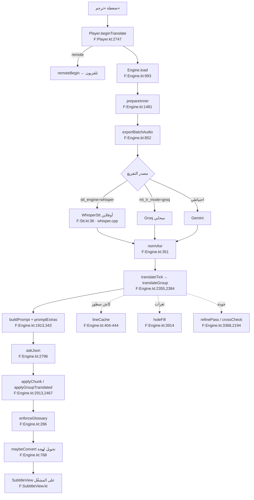
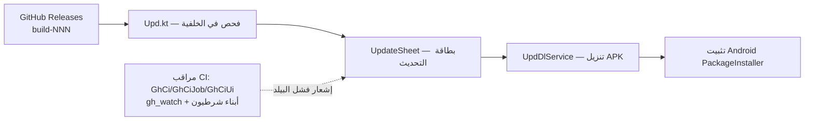
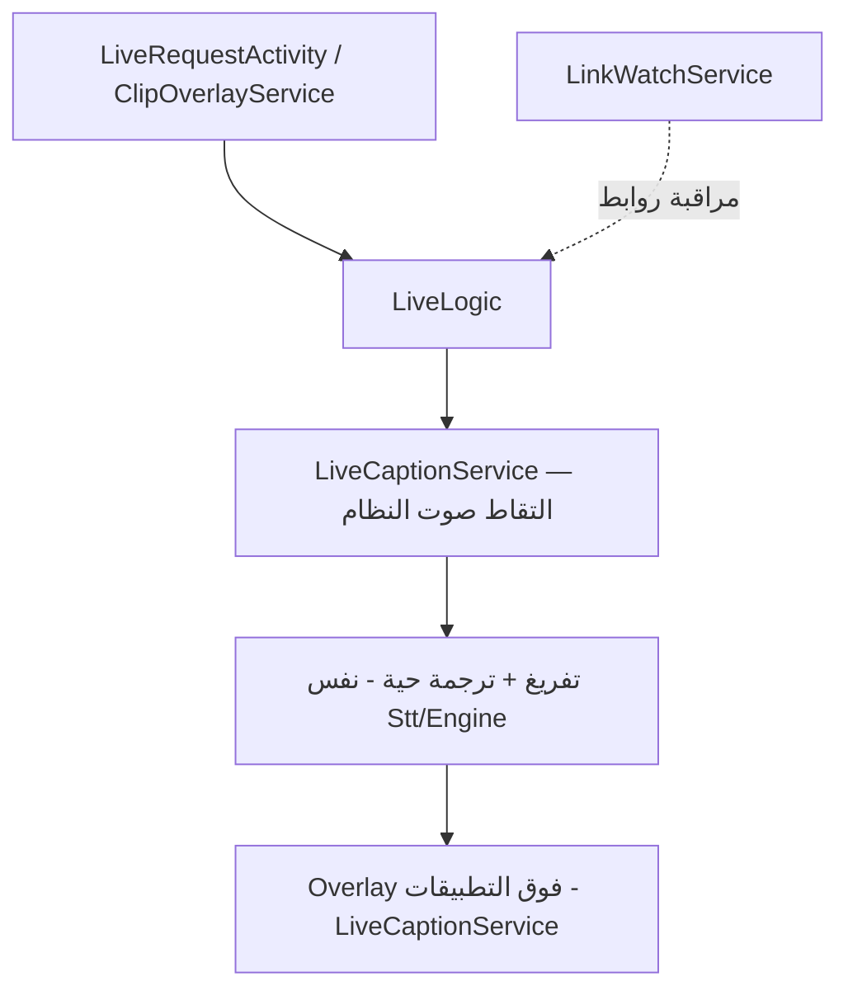
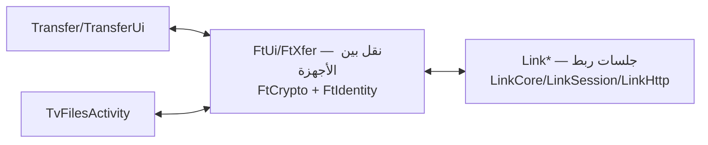
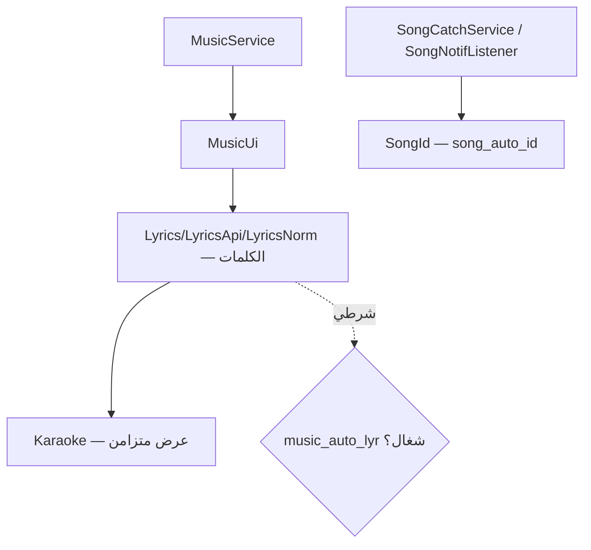

# 🗺 JOYBOY COMPLETE FLOW MAP

> HEAD `d3169383` (v13.91). خرائط Mermaid منفصلة لكل مسار (الخريطة الواحدة مش هتسع). المعرفات ثابتة: `F:<ملف>:<سطر>`. العلاقات المتقطعة = ديناميكية (Intent/Handler/Callback).

## A. بدء التطبيق



- مكونات Manifest: 17 activity + 16 service + 7 receiver + 1 provider (AndroidManifest.xml).
- UiWatchdog (Main.kt:144): مراقب تهنيج الواجهة — مصدر لوجات ⛔ اللي اتبنى عليها إصلاح v1389.

## B. مسار ترجمة فيديو (يوتيوب/متصفح/ملفات)



التفاصيل الكاملة في JOYBOY_TRANSLATION_ENGINE_FLOW.md.

## C. مسار التحديث (OTA عبر GitHub)



- الصفوف الشرطية (v1392): gh_notify/gh_prelog/gh_tv_auto تحت gh_watch (GhCiUi.kt:140-162).
- القاعدة الذهبية: versionCode = وقت البناء بالدقايق (app/build.gradle.kts:23-24) — أي بيلد أحدث يتثبت فوق القديم بدون فقد بيانات.

## D. مسار الالتقاط الحي (Live Caption)



- إعدادات `lw_*` (المالك: تبويب capture) — الأب `lw_web_off` وأبناؤه lw_toast_off/lw_hist_off (شرطيون من v1392، Settings.kt R rows + Main.kt).

## E. مسار التلفزيون

```mermaid
flowchart TD
    TV[TvActivity / TvHomeAlias] --> TH[TvHome.showHome<br/>F:TvHome.kt:3021]
    TH --> TS[TvSkin* — 7 ملفات سكنات]
    TH --> TP[TvPlayerBar / TvDirect — تشغيل]
    TP --> CS[CastServer — بث للتلفزيون<br/>SubSidecar ~186-253]
    M[الموبايل] -.RemoteClient.cmd.-> RS[RemoteService على التلفزيون]
    M -.tvOv تجاوز الإعدادات.-> TE[TvEdit — نسخة التلفزيون من الإعدادات]
    IR[IrWizard/IrProfiles — قواعد بيانات IR<br/>assets/irdb_*.txt] --> RM[RemoteActivity — ريموت]
```

## F. مسار نقل الملفات والربط



## G. مسار الموسيقى



## H. مسار الصيانة (Care)

CareKit كمنسق + CareApps/CareClean/CareSecurity/CareBattery/CareDevice/CareSpeed/CarePrivacy (واجهات *Ui منفصلة) + CareMetrics/CareRings/CareScanExtra — 14 ملف، أقل عائلة ارتباطًا بالباقي (ميزة معمارية جيدة).

## علاقات ديناميكية حرجة (غير ظاهرة في جراف النداء الساكن)

| العلاقة | النوع | الدليل |
|---|---|---|
| Manifest components ← نظام أندرويد | Intent/Launcher | AndroidManifest.xml (41 مكون) |
| Widgets (7) ← AppWidgetManager | Broadcast | LiveWidget/SongWidget/PrayerWidget/MusicWidget/TasksWidget/ActionsWidget |
| RemoteClient.cmd → RemoteService | شبكة/أوامر نصية | TvEdit.kt: (open_settings) |
| WebView JS bridge في المتصفح | @JavascriptInterface | Browser.kt + VidHook/Sniffer |
| UiWatchdog → LogStore | مراقب خيط الواجهة | Main.kt:144 |
| BootReceiver → خدمات الخلفية | BOOT_COMPLETED | AndroidManifest.xml |
| host.log/notice في Engine | callback عبر واجهة host | Engine.kt (متفرقات) |
