# 🔗 JOYBOY SETTINGS DEPENDENCY GRAPH

> HEAD `d3169383` (v13.91) + ملاحظات v1392/v1393. القاعدة (طلب علي): الابن **مختفي** لحد ما الأب يتفعّل · القيمة المحفوظة **ما تتمسحش** بقفل الأب · الظهور/الاختفاء **فوري** (recreate/رسم من جديد). آليتا تنفيذ: (1) `if (Cfg...) ui.section(...) else null` في لامبدا التبويب، (2) حقلَي `parent`/`parentHideVal` في صفوف AdvRows (v1392، Settings.kt:504,527-528).

## 1) الأشجار الشرطية الحية (مع الدليل)

```mermaid
flowchart TD
    STT[stt_offline = on] --> W1[📴 موديل الويشبر وتنزيله]
    STT --> W2[⚡ أداء الويشبر]
    STT --> W3[🗣 لغة الكلام]
    GROQ[stt_offline = off + mt_tr_mode = groq] --> G1[⚡ خيارات جروك]
    MAL[music_auto_lyr ≠ 0] --> L1[🔤 شكل الكلمات: lyr_font + lyr_size]
    GLASS[MtGlass.on] --> P1[🎬 مظهر المشغّل - MeeTube]
    LW[lw_web_off ≠ 1 - المراقب شغال] --> LT[lw_toast_off إخفاء الإشعارات]
    LW --> LH[lw_hist_off عدم حفظ السجل]
    GH[gh_watch شغال] --> GN[gh_notify]
    GH --> GP[gh_prelog]
    GH --> GT[gh_tv_auto]
    TV[Cfg.tvOv ≠ null] --> TB[شريط «بتعدّل نسخة التلفزيون» + زرار الرجوع]
    STRICT[Strict.hideTrOpts - وضع مبسّط] --> DIAL[قسم اللهجة والأسلوب يتخبّى]
```

| الأب | الأبناء | التنفيذ | الدليل |
|---|---|---|---|
| `stt_offline` = on | 3 أقسام ويشبر | if/null في لامبدا التبويب + recreate عند تغيير المحرك | Main.kt (تبويب الترجمة بعد v1393) |
| `mt_tr_mode` = groq | قسم خيارات جروك | if/null | Main.kt (الترجمة بعد v1393) |
| `music_auto_lyr` ≠ "0" | شكل الكلمات | if/null + recreate في التوجّل | Main.kt تبويب الموسيقى (v1390) |
| `MtGlass.on()` | مظهر المشغّل | if/null | Main.kt (المظهر والواجهة بعد v1393) |
| `lw_web_off` = "1" (مقفول) | يخبّي lw_toast_off/lw_hist_off | parent/parentHideVal في AdvRows | Settings.kt R rows (v1392) |
| `gh_watch` | gh_notify/gh_prelog/gh_tv_auto | if/null + dismiss/reopen | GhCiUi.kt:140-162 (v1392) |
| `Cfg.tvOv != null` | شريط التنبيه + زرار الرجوع | if/else في تبويب التلفزيون | Main.kt tvset builder |
| `Strict.hideTrOpts()` | قسم اللهجة والأسلوب | visibility = GONE | Main.kt general + Strict.kt:25 |

## 2) اعتماديات قيمة (مش ظهور)

| المفتاح | الأثر | الدليل |
|---|---|---|
| `hitiming` = on | فك الصوت بـ pre-roll 3 ثواني قبل البداية | Engine.kt:1402 (`if (conf.hiTiming \|\| TrSlider.on("hitiming")) 3.0`) + Core.kt:297 |
| `mt_tr_mode` = groq | مفتاح جروك مطلوب — غيابه بينبّه في الواجهة | Main.kt (تنبيه المفتاح الناقص) |
| `tr_mode_id` = loc_ctx | `ctx_batches` بيتقفل 2-3 | Engine.kt:2500 |
| `tr_method` = google | التفريغ يتحوّل ويشبر تلقائي (stt_offline=1, mt_tr_mode=whisper) | Main.kt chips الترجمة |
| `upd_auto` | تنزيل تلقائي + سؤال التثبيت | Upd.kt:43,425 |

## 3) tvOv — نسخة التلفزيون (ممنوع كسرها)

`Cfg.tvOv` (Core.kt:163, خريطة متزامنة @Volatile): لما بتتفعّل (TvEdit.enter)، قراءة `Cfg.str/int/bool` للمفاتيح المشتركة بترجع قيمة التلفزيون (Core.kt:165,242). الخروج TvEdit.exit. مزامنة تلقائية مفروضة إلا لو `tv_sync_off` = "1" (Main.kt تبويب التلفزيون). أي إعداد مشترك لازم يفضل راكب على Cfg مش على قراءة SharedPreferences مباشرة عشان الآلية تفضل شغالة.

## 4) اعتماديات مقترحة (لسه منفذتش — من SETTINGS_DEPENDENCIES_MAP)

| الأب المقترح | الأبناء | ملاحظة |
|---|---|---|
| قفل التطبيق | خيارات البصمة/المدة | صفوف الأمان الحالية أزرار — التحويل لشجرة يحتاج إعادة تصميم صف |
| `bg_autostart` | قسم «عشان الجهاز ما يقتلش الخدمة» | التعليمات لازمة فقط لو التشغيل التلقائي مفعّل |
| غير أجهزة TV | إخفاء صفوف TV-only | «Never expose settings whose required feature is unavailable» |

## 5) اختبار القبول لكل شجرة
تفعيل الأب ← الابن يظهر فورًا · قفل الأب ← الابن يختفي وقيمته محفوظة بعد إعادة التفعيل. (SETTINGS_REGRESSION_TEST_PLAN §2)
